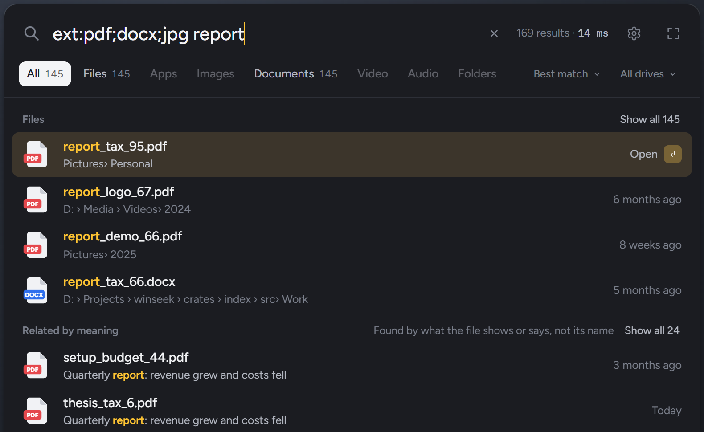
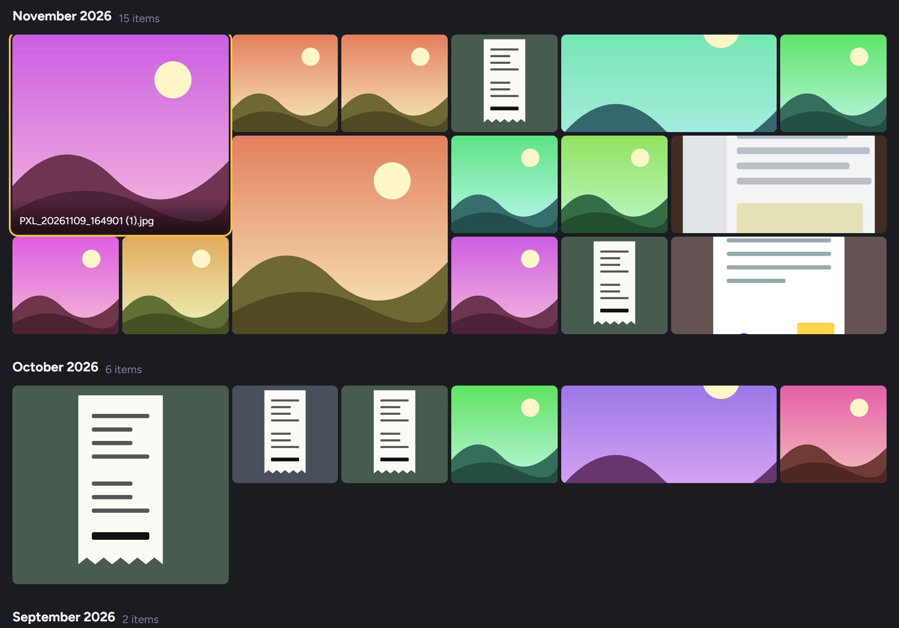

# winseek

[](https://github.com/ach-raf/winseek/actions/workflows/ci.yml)
[](https://github.com/ach-raf/winseek/releases)
[](#license)

File search for Windows with two modes: instant name search over every drive, and search by what files contain (photos, scans, PDFs). Everything runs locally.

<p align="center"></p>

Press `Alt+Space`, type `report`, and every file with "report" in its name appears in milliseconds, across all drives. Type `a dog on the beach` or `invoice total` and winseek finds the photo or scanned document whose contents match, using embeddings computed on your machine.

Status: early development, version 0.2.x. The name index, live updates, and image and document search work end to end. Tested on Windows 10 x64 with an NVIDIA RTX 3060. The Vulkan and CPU fallbacks work but get less testing. The installer is unsigned.

<p align="center"></p>

## What it searches

| Target | Examples |
|---|---|
| File and folder names | `invoice`, `report 2024`, `*.psd`, `ext:jpg;png beach`, `folder:downloads contract`. Covers NTFS, ReFS, exFAT and FAT volumes, including USB drives. |
| Images | `sunset over the sea`, `a whiteboard with diagrams` |
| Documents and PDFs | `bank statement`, `contract notice period`. Scanned pages are read with OCR or a vision model. |

Name search covers every file on every volume. Meaning search covers only the folders you pick (default: Pictures, Documents, Desktop, Downloads).

## Install

Requires Windows 10 or 11 (x64). WebView2 is installed automatically if missing.

1. Download `winseek_<version>_x64-setup.exe` from [Releases](https://github.com/ach-raf/winseek/releases). A `.sha256` file sits next to it.
2. Run it and approve the UAC prompt. Administrator rights are needed once, to install the `searchd` service.
3. On first launch, choose which models to download. Both are optional and resumable: about 825 MB for search by meaning, about 1.5 GB for the document parser.

The installer is not code-signed, so SmartScreen will warn you. Choose "More info", then "Run anyway", or build from source.

Any GPU works. An NVIDIA card with CUDA 12.x indexes fastest. AMD and Intel use Vulkan, and everything else falls back to the CPU.

## How it works

```
                    Alt+Space
                       │
        ┌──────────────▼───────────────┐         ┌──────────────────────────────┐
        │  winseek-app (Tauri, user)   │         │  searchd (Windows service)   │
        │                              │  named  │                              │
        │  popup · library · preview   │◄───────►│  raw $MFT scan, USN journal, │
        │  Tier 1 indexing worker      │  pipe   │  name index (Tier 0 only)    │
        └───────┬──────────────┬───────┘         └──────────────────────────────┘
                │              │
                ▼              ▼
        ┌───────────────┐ ┌──────────────────────┐
        │ llama-server  │ │ llama-server         │
        │ EmbeddingGemma│ │ Infinity-Parser2-    │
        │               │ │ Flash                │
        └───────────────┘ └──────────────────────┘
          spawned on demand · localhost only · stopped when idle
```

- **`searchd`** runs as a service and owns the name index. It reads the NTFS master file table directly, as WizTree and Everything do, and applies renames, creations and deletions from the USN change journal within about a second. A snapshot on disk makes restarts quick. Non-NTFS drives use a folder watcher, and ReFS has its own journal walker. `searchd` never reads file contents and never loads a model.
- **`winseek-app`** runs as your user. It provides the popup, library and preview, and it is the only process that reads file contents and computes embeddings. Because it is unprivileged, it respects file permissions, and no model code runs as SYSTEM.
- **`llama-server`** child processes host the two models. They start when there is work, listen on 127.0.0.1 with a per-launch API key, and exit after two idle minutes.

Everything is stored in one SQLite file (FTS5 for text, a vector table for embeddings, USN cursors, settings). If the file is damaged, winseek salvages what it can and rebuilds the rest.

### Name search

A full scan of C: (5.95 million files and folders) takes about 33 seconds. Restoring the saved snapshot takes under 5.

| Query | Matches |
|---|---|
| `invoice report` | names containing both terms |
| `"exact phrase"` | the phrase verbatim |
| `*.psd` | wildcard (`*`, `?`) against the whole name |
| `ext:jpg;png` | files with those extensions |
| `folder:`, `file:` | only folders, or only files |
| `docs\2024` | a term containing `\` matches against the path |

### Search by meaning

Text and images are embedded with EmbeddingGemma-2 (Q8_0 GGUF, about 310 MB plus a 555 MB vision encoder) on llama.cpp. Raw cosine similarity is a poor ranking signal on its own, so results pass through a relevance gate whose threshold is learned from your own index. On a 20-query evaluation it raised precision at the top of the list from 0.22 to 0.70.

- Querying runs on the CPU (about 30 ms and 300 MB RAM per query), so a search never takes VRAM from a game.
- Indexing peaks around 2 GB of VRAM. The image encoder and document parser never run together.
- Low, Balanced and Fast profiles trade speed for memory.
- Models are downloaded from pinned llama.cpp releases, checked against SHA-256, and fall back from CUDA to Vulkan to CPU if a build fails its health check.

### Document parsing

Windows OCR handles clean screenshots. When extracted text is sparse or garbled (in any script), the page goes to Infinity-Parser2-Flash, a 2B vision model that outputs Markdown with tables as HTML. It is a separate download of about 1.5 GB, optional, and takes roughly 2 to 3 seconds per page on an RTX 3060. From the preview you can copy any detected table as HTML or Markdown.

It is weak on complex charts and rotated tables. Pages it cannot read confidently are skipped rather than indexed as guesses.

## Use from AI agents

`winseek-mcp.exe` is a read-only MCP server. Clients get name search with type, date and size filters, search by meaning, text extraction from PDFs and Office files, app and Settings lookup, and index status. It cannot open, launch, rename or delete anything.

Enable it under Settings › Agents (off by default), then for Claude Code:

```
claude mcp add winseek -- "C:\Program Files\winseek\winseek-mcp.exe"
```

Snippets for Claude Desktop, Cursor, VS Code and Codex are in the same settings page. Every agent call is logged there.

## Privacy

Indexes, models and queries stay on your machine. There is no telemetry and no account. The only network traffic is the model download you start from Settings. `searchd` cannot read file contents, and the content worker runs as your user, so files you cannot read are not indexed.

## Keyboard shortcuts

| Key | Action |
|---|---|
| `Alt+Space` | show or hide winseek |
| `↑` `↓` | move through results |
| `Space` | preview the selected result |
| `Enter` | open |
| `Esc` | hide |

## Build from source

You need Rust (stable, MSVC toolchain) and Node 18 or newer.

```powershell
git clone https://github.com/ach-raf/winseek.git
cd winseek
powershell -ExecutionPolicy Bypass -File scripts\build-installer.ps1
# output: target\release\bundle\nsis\winseek_<version>_x64-setup.exe
```

For development, run the service in an elevated console. Elevated runs lose stdout, so it logs to a file. Then start the app against the dev server:

```powershell
cargo run -p searchd -- --console     # elevated terminal
cd app; npm install; npm run tauri dev
```

Run tests with `cargo test -p <crate>` for each workspace member and `npm test` in `app/ui`.

### Releasing

CI builds and tests every push to `master` and uploads the installer as a build artifact. To publish a release, bump the version in `Cargo.toml` and `app/src-tauri/tauri.conf.json`, then push a matching tag:

```powershell
git tag v0.3.0
git push origin v0.3.0
```

The release workflow checks that the tag matches both versions, builds the installer, and attaches it with a SHA-256 file. Release notes are generated from [Conventional Commits](https://www.conventionalcommits.org/) (`feat:`, `fix:`, `perf:`).

## FAQ

**How does this differ from Everything?** Everything searches names and does it very well. winseek's name tier uses the same scan-and-journal approach, and adds a second tier that reads file contents.

**Where is my data?** The program is in `C:\Program Files\winseek`. The index, models and settings are in `%LOCALAPPDATA%\winseek`. Uninstalling removes the program and service. Delete the `%LOCALAPPDATA%` folder to reclaim model and index space.

## Roadmap

- `size:` and date filters in the name query syntax
- Show why a result matched, with the region highlighted on parsed pages
- Video and audio indexing through transcripts (FFmpeg sidecar)
- Opt-in text and code indexing that respects `.gitignore`
- More sort orders and columns

## Credits

- [DigUp](https://github.com/ARahim3/DigUp) by Abdur Rahim inspired on-device search by meaning. Its credits lead to [VectorDash](https://github.com/ampersandru/VectorDash), the Windows design reference.
- [Everything](https://www.voidtools.com/) by David Carpenter, for the scan-and-journal architecture.
- WizTree and wiztree-rs, the source of the raw `$MFT` scanner in the `ntfs` crate.
- [llama.cpp](https://github.com/ggml-org/llama.cpp), EmbeddingGemma-2, [Infinity-Parser2-Flash](https://huggingface.co/infly/Infinity-Parser2-Flash), pdfium, sqlite-vec and Tauri.

Third-party licenses are in [THIRD_PARTY_NOTICES.md](THIRD_PARTY_NOTICES.md).

## License

MIT, see [LICENSE](LICENSE).
